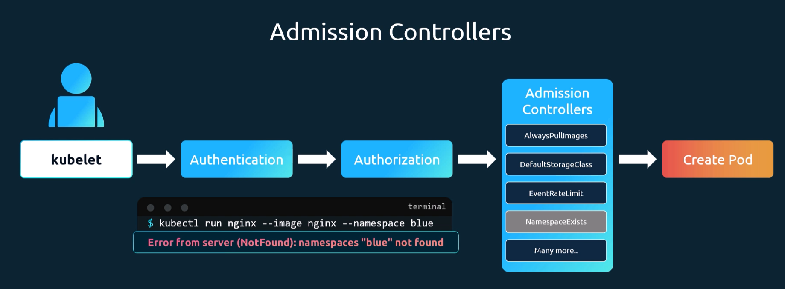

# Admission controllers
Admission controllers are plugins that govern and enforce how the cluster is used. They can be used to validate requests to the Kubernetes API server, mutate objects before they are persisted, or even reject requests based on custom logic.



List of admission controllers
```bash
kubectl exec kube-apiserver -n kube-system -- kube-apiserver -h | grep enable-admission-plugins
#
kube-apiserver -h
```

## Changing admission plugins

You can edit the kube-apiserver manifest file to enable or disable admission controllers. The manifest file is usually located at `/etc/kubernetes/manifests/kube-apiserver.yaml` on the master node.

Flags for admission controllers
```bash
--enable-admission-plugins=<admission_controller_1>,<admission_controller_2>,...
--disable-admission-plugins=<admission_controller_1>,<admission_controller_2>,...
```

Flag for custom admission controllers. NOTE: This path has to be mounted to the kube-apiserver container in order for the admission controller to be able to read it.
```bash
--admission-control-config-file=<path_to_config_file>
```
