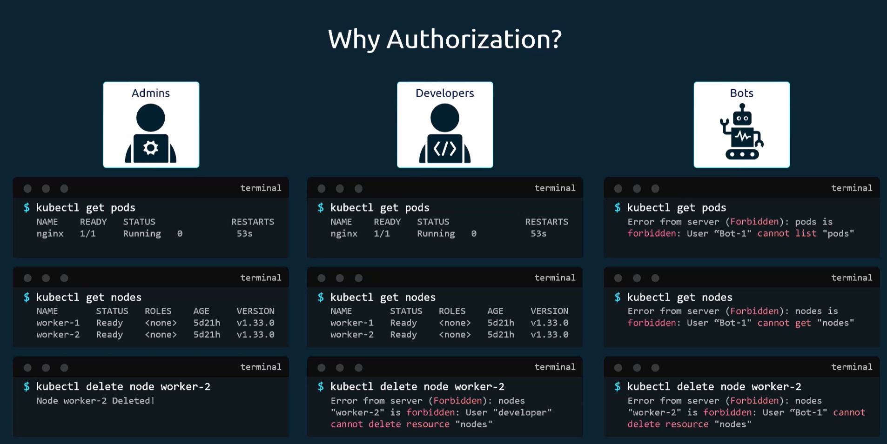
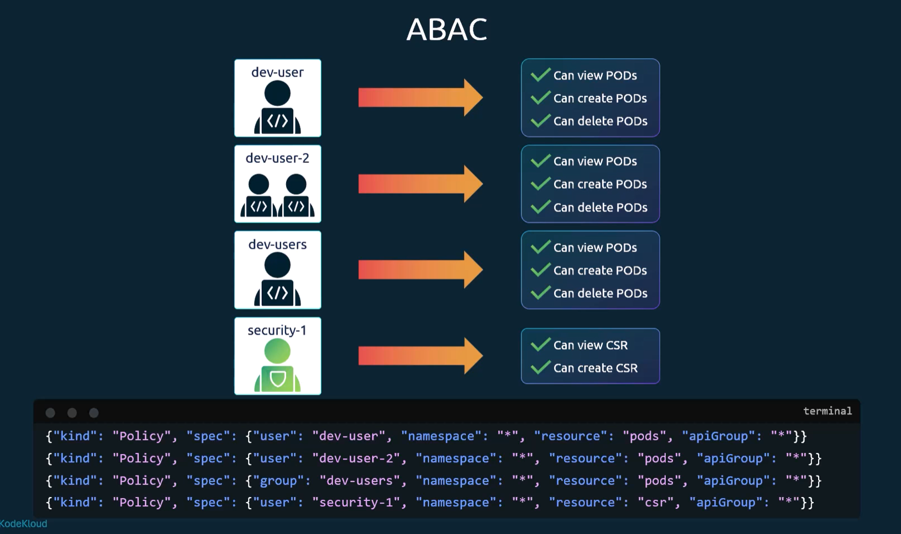
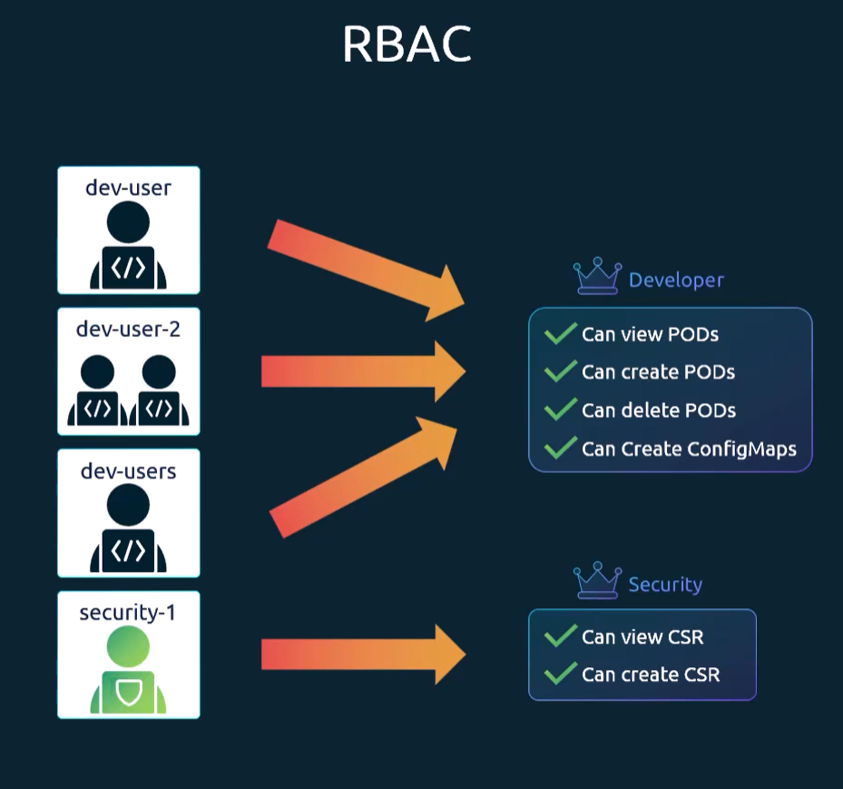
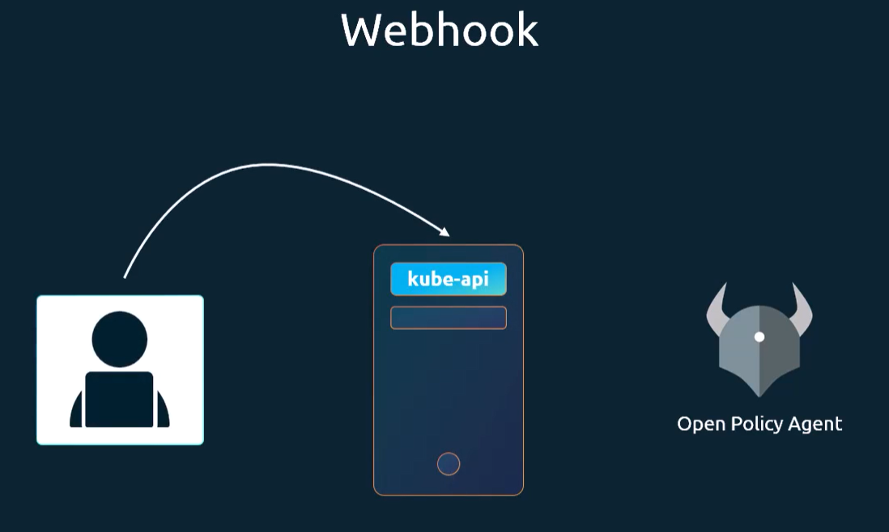

# Authorization in Kubernetes
We need a way to deal with the question of "who can do what" in a Kubernetes cluster. 
Kubernetes provides several mechanisms for that.

## ABAC (Attribute-Based Access Control)
In ABAC, each user gets a set of attributes, defining what they can do.

## RBAC (Role-Based Access Control)
In RBAC, you define roles that have certain permissions. Then, you assign those roles to users.

## Webhook
In Webhook, the kube-apiserver sends a request to an external webhook service to ask if the user can perform the requested action.

## AlwaysAllow and AlwaysDeny

## Setting the Authorization Mode
The authorization mode is set in the kube-apiserver configuration. You can specify multiple modes, and they will be evaluated in the order they are listed. The first mode that allows or denies the request will determine the outcome.

--authorization-mode=RBAC,ABAC,Webhook,AlwaysAllow,AlwaysDeny

AlwaysAllow is the default one.