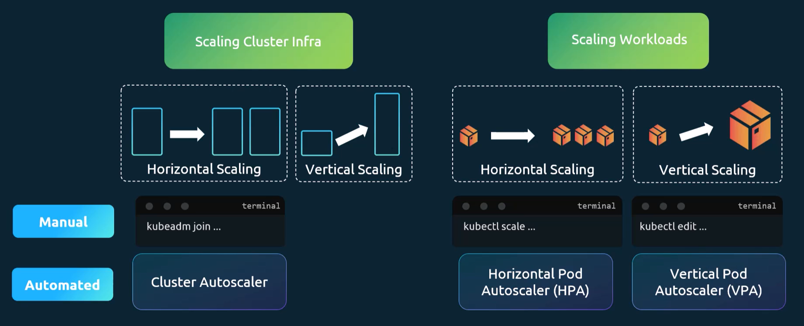
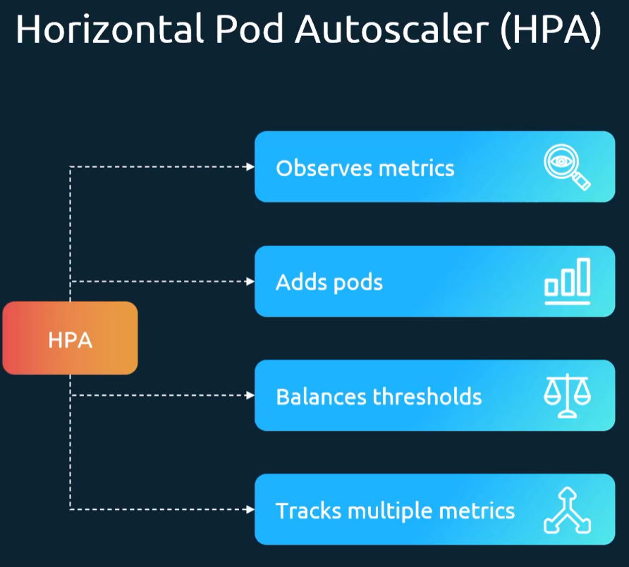

# Autoscaling
Lets imagine we have a physical server with some resources. If the server runs out of resources for the apps being run, we can add more resources or add more servers.

Adding more resources is called *vertical scaling*.
Adding more servers is called *horizontal scaling*.

## In Kubernetes
In Kubernetes, there are two types of scaling, each with their own version of horizontal and vertical scaling.
1. Scaling Cluster Infrastructure:
- Horizontal scaling means adding more nodes to the cluster. 
- Vertical scaling means adding more resources to the nodes in the cluster.
2. Scaling Workloads:
- Horizontal scaling means adding more replicas of a workload (e.g., pods).
- Vertical scaling means adding more resources to the workload (e.g., increasing CPU or memory limits).

We can do it manually or automatically.



# Manual Scaling
If I were to do it manually, I would have to monitor the resources being used by the workloads and then scale them up or down as needed.
```bash
kubectl top pod <pod_name> # requires metrics-server to be installed
kubectl scale deployment <deployment_name> --replicas=<number_of_replicas>
```

# In-place vertical scaling
In older versions of Kubernetes, to change memory/cpu limits/request, a pod had to be deleted and recreated. In newer versions, we can do it in-place.
https://kubernetes.io/docs/tasks/configure-pod-container/resize-container-resources/

# HPA (Horizontal Pod Autoscaler)
Automatically scales the number of pods based on observed metric and set usage thresholds.



```sh
kubectl autoscale deployment <deployment_name> --cpu-percent=<target_cpu_utilization_percentage> --min=<min_replicas> --max=<max_replicas>
kubectl get hpa --watch*
```

[Example](HPA.yaml)
