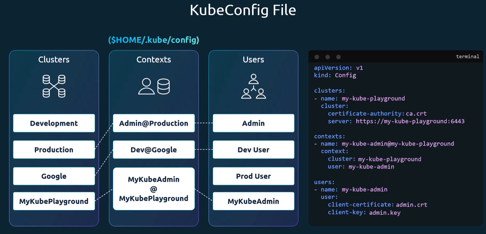

# Kubectl config
Whenever you make a request via kubectl, you pass a configuration file that contains information about the clusters, users, and contexts.

It also stores the credentials and certificates needed to authenticate with the Kubernetes API server.

This configuration file is usually located at `~/.kube/config` by default, in a kubernetes Config object.


**

To view the current configuration, you can use the following command:
```bash
kubectl config view
```

## Contexts
You can specify a default context in the config file, by setting the `current-context` field.

You can also view the available contexts and switch between them using the following commands:
```bash
kubectl config --help
kubectl config get-contexts
kubectl config use-context <context_name>
```

## **
1. Instead of providing file paths for certificates, you can provide the base64 encoded cert directly with --certificate-authority-data, --client-certificate-data, and --client-key-data flags.
2. You can select a default namespace for a context by adding a `namespace` field to the context in the config file.