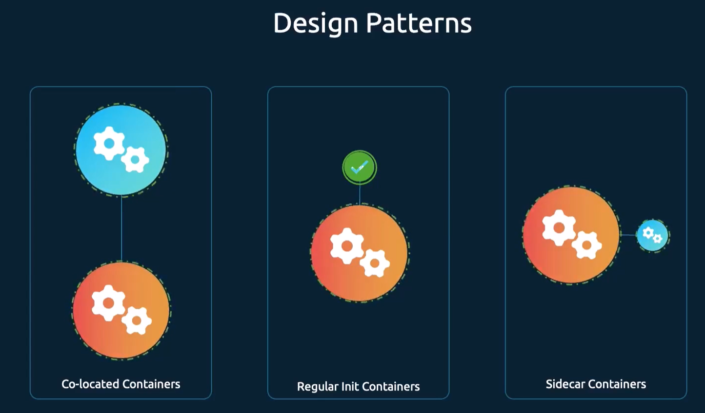

# Multi container pods
You can have multiple containers running inside a single pod.
Example usecases are logging and monitoring containers, init containers that for example download some data before the main container starts, etc.

[Colocated containers](./colocated.yaml) - containers that start and stop together, and share the same lifecycle.
[Init containers](./init.yaml) - allow us to specify a startup order.
[Sidecar containers](./sidecar.yaml) - provide additional functionality to the main container.

## Co-located vs Sidecar containers
Co-located containers start and stop together, and share the same lifecycle.
Sidecar containers allow us to specify a startup order.

