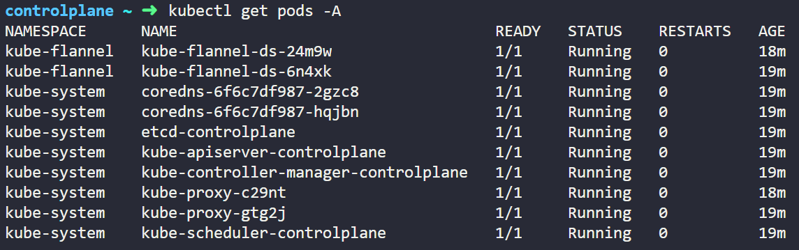

# Static pods
Static pods are managed directly by the kubelet daemon on a specific node.
They are defined in a manifest file and placed in a specific directory on the node. 
The kubelet monitors this directory and automatically creates and manages the static pods defined in the manifest files.

## Steps to create a static pod
1. Create a manifest file for the static pod (e.g., `static-pod.yaml`).
2. Place the manifest file in the kubelet's static pod directory (e.g., `/etc/kubernetes/manifests/`).
3. The kubelet will automatically create the static pod based on the manifest file.
4. You can also restart the kubelet service to ensure it picks up the new manifest file.

```sh
systemctl restart kubelet
```

You can modify the kubelet configuration to specify a different directory for static pod manifests if needed.

The configuration file is usually located at `/var/lib/kubelet/config.yaml`. You can change the `staticPodPath` field to point to a different directory.

https://kubernetes.io/docs/tasks/configure-pod-container/static-pod/

## Use cases for static pods
- **Critical system components**: Static pods are often used for running critical system components like the setting up the master node components (API server, controller manager, scheduler) in a Kubernetes cluster.

## How to identify static pods

### Question 1
Identify static pods from the following pods.



A simple check is to look at their names. Static pods end with the name of their node. In the image, all of the -controlplane pods are static pods because they end with the name of their node (e.g., `-controlplane`).

Another option is to check `kubectl get pod <pod_name> -o yaml` and look at the `metadata.ownerReferences`.
