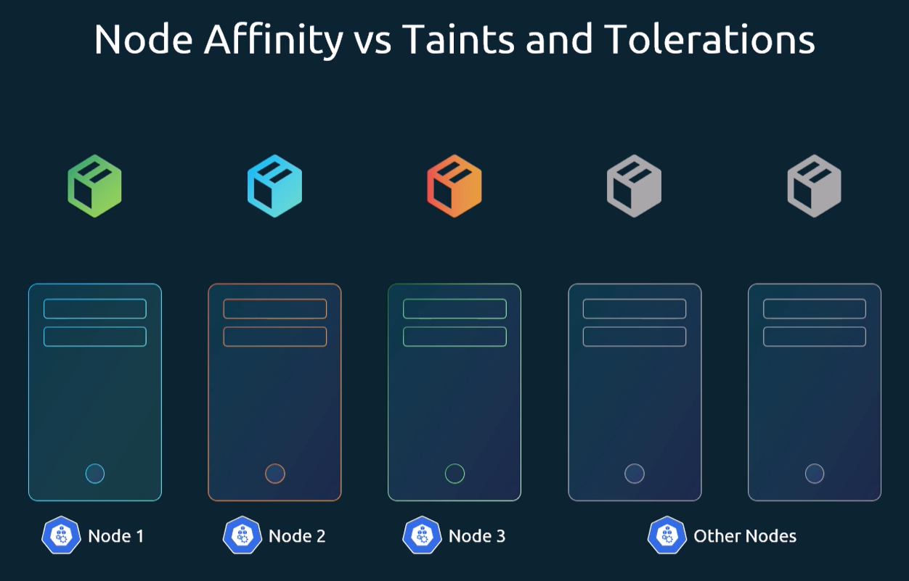
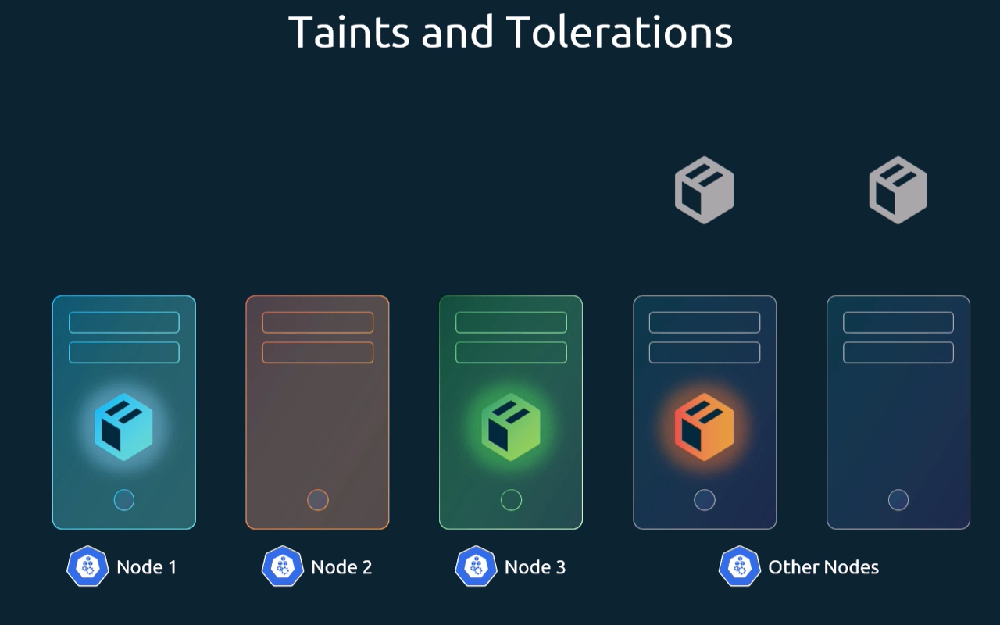
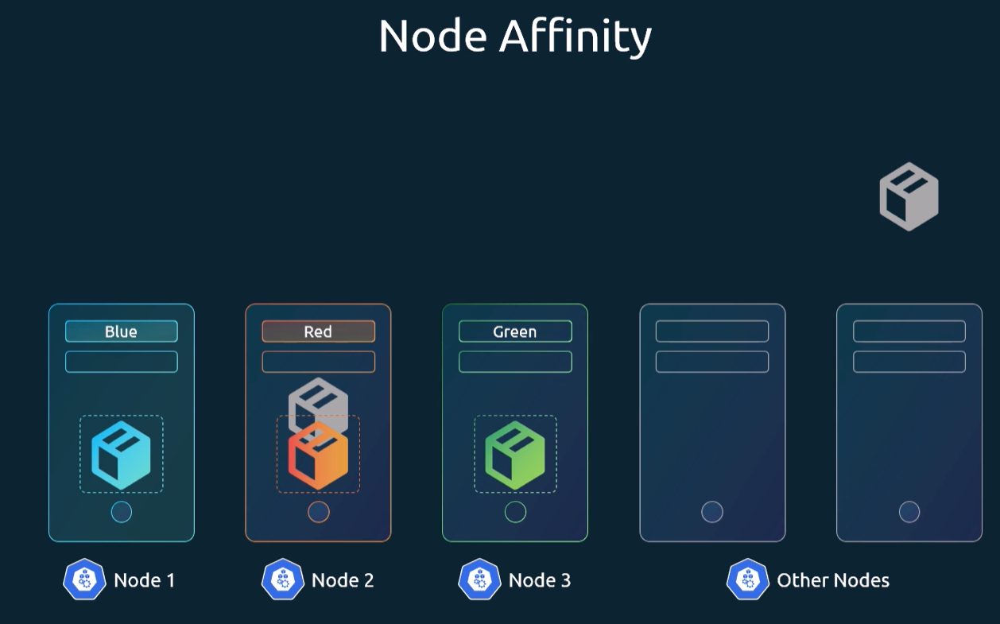
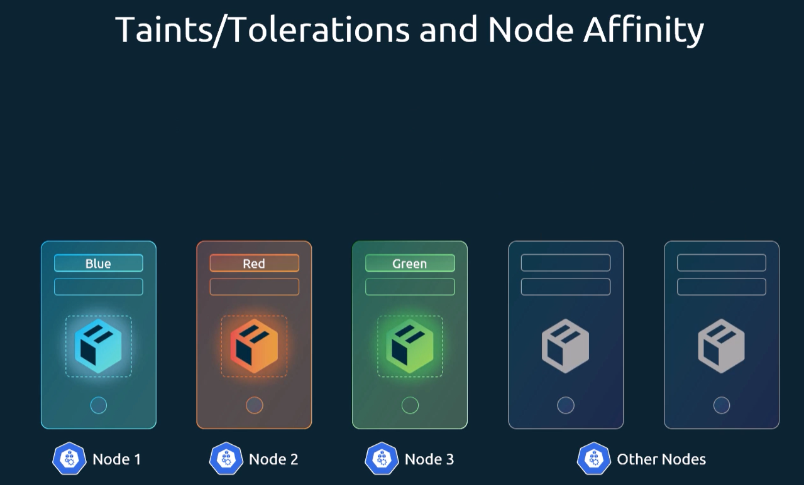

Lets say we have 5 nodes and 5 pods. 3 of those pods have to go to their 3 respective nodes, and the other 2 pods can go to any of the remaining 2 nodes. We can achieve this by combining taints and tolerations with node affinity.

## Using taints
We can taint the 3 nodes and add tolerations to the 3 pods that need to go to those nodes.
This ensures the other 2 pods will not be scheduled on those 3 nodes.
However, it's still possible that one of the 3 pods will be scheduled on one of the 2 remaining nodes.

## Using affinity
We can use affinity to add labels and selectors to the 3 pods and 3 nodes. 
This ensures that the 3 pods will only be scheduled on their respective nodes.
However, it's still possible that one of the 2 remaining pods will be scheduled on one of the 3 nodes.

## Combining taints and affinity
Combining both, we can ensure the 3 pods will be scheduled on their respective nodes, and the other 2 pods will be scheduled on the remaining 2 nodes.

