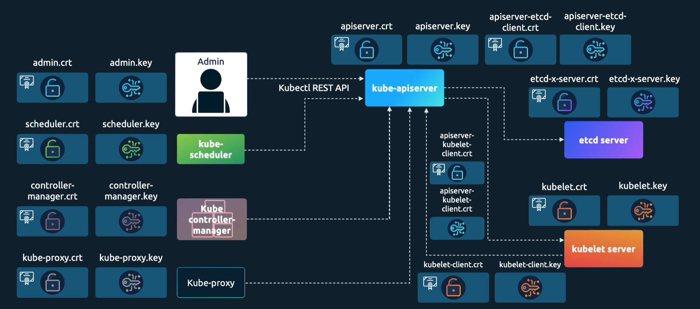
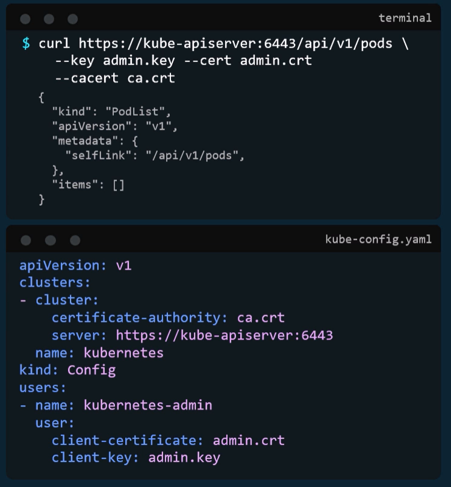

# TLS in K8S
Server and client certificates are used to secure communication between clients and servers in Kubernetes.

Servers that receive requests are, for example, the api-server, the kubelet or the etcd. They need certificates to prove their identity to clients.

Clients that send requests are, for example, the kubectl command line tool or the kubelet. They need certificates to prove their identity to servers.



# Generating certificates
You can generate certificates using the `openssl`, `cfssl` or `easy-rsa` tools. 
The certificates can be self-signed or signed by a trusted certificate authority (CA).

## OpenSSL example
```bash
# Generate a private key
openssl genrsa -out ca.key 2048
# Generate a certificate signing request (CSR). 
# Provide a relevant name for the Common Name (CN) field. 
# Provide a relevant name for the Organizational Unit (OU) (group) field.
openssl req -new -key ca.key -subj "/CN=KUBERNETES-CA/OU=system:kubernetes" -out ca.csr
# Generate a self-signed certificate
openssl x509 -req -in ca.csr -signkey ca.key -out ca.crt
```

Self-signed certificates are suitable for testing and development purposes, but for production environments, it is recommended to use certificates signed by a trusted CA.

We can use the generated `ca.crt` and `ca.key` files to sign other certificates for the Kubernetes components. For example, for an admin user:
```bash
# Generate a private key for the admin user
openssl genrsa -out admin.key 2048
# Generate a certificate signing request (CSR) for the admin user. Provide a relevant name for the Common Name (CN) field.
openssl req -new -key admin.key -subj "/CN=admin/OU=system:masters" -out admin.csr
# Sign the admin user's CSR with both the CA certificate and the CA private key.
openssl x509 -req -in admin.csr -CA ca.crt -CAkey ca.key -CAcreateserial -out admin.crt -days 365
```

## Usage of certificates
We can use the generated certificates to secure and authenticate communication.



## Viewing certificate details in Kubernetes
```bash
kubectl get all -A
kubectl describe <object_type>/<object_name> -n <namespace> | grep -i cert
```

Once you find a certificate, you can view its details using the `openssl` command.
It can show you the certificate's subject, issuer, validity period, and other information.
```bash
openssl x509 -in <certificate_file> -text -noout
```