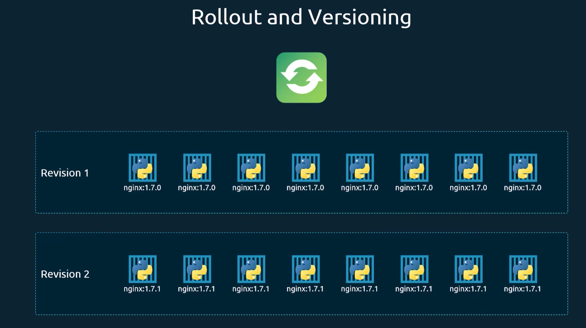

# Rollout
Creating a deployment trigger a 'rollout'.
Rollout creates a new ReplicaSet with a new revision.
This allows you to roll back to a previous revision.



Useful commands for rollout
```bash
kubectl rollout status deployment/<deployment_name>
kubectl rollout history deployment/<deployment_name>
kubectl rollout undo deployment/<deployment_name> --to-revision=<revision_number>
```

Rollout revision is created when updating deployment.
```bash
kubectl apply -f <deployment_file>.yaml
kubectl set image deployment/<deployment_name> <container_name>=<new_image>
```

We can also check rollout history and stratiegies from the describe command.
```bash
kubectl describe deployment <deployment_name>
```

## Rollout strategies

### Recreate
The recreate strategy terminates all existing pods at once before creating new ones. This can lead to downtime, but it ensures that there is no overlap between the old and new versions of the application.

### RollingUpdate (default)
The rolling update strategy gradually replaces old pods with new ones, ensuring that there is no downtime during the update process. This is the default strategy for deployments in Kubernetes.

# Rollback
Rollback allows you to revert to a previous revision of a deployment.

```bash
kubectl rollout undo deployment/<deployment_name> --to-revision=<revision_number>
```

Deployments create replicasets with a new revision when updated. Running
```bash
kubectl get replicasets
```
after updating a deployment will show two replicasets, the old one and the new one. The old one will be scaled down to 0 replicas.
Running `kubectl rollout undo` will scale the old replicaset back up to the previous number of replicas and scale the new replicaset down to 0 replicas. This effectively rolls back the deployment to the previous revision.